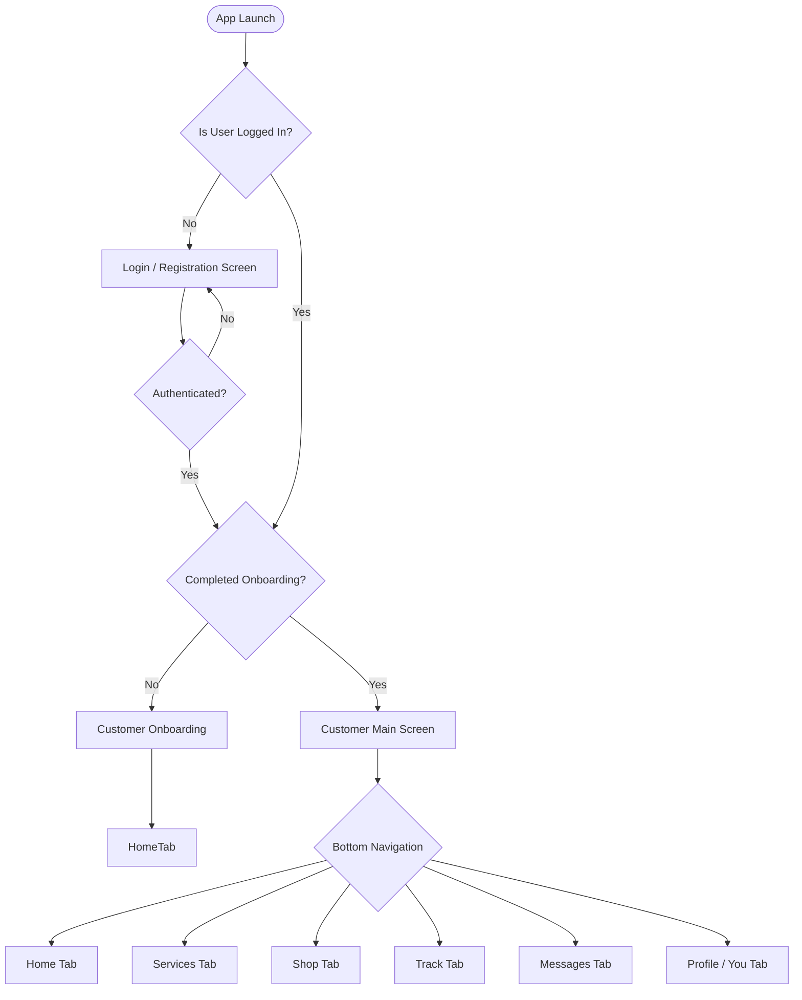
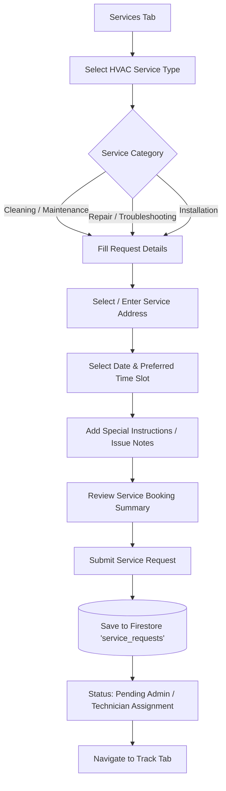
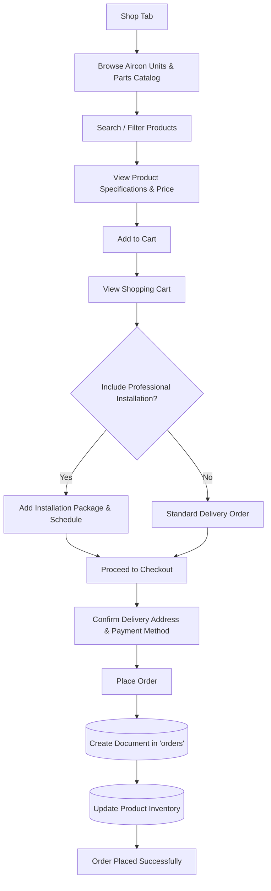
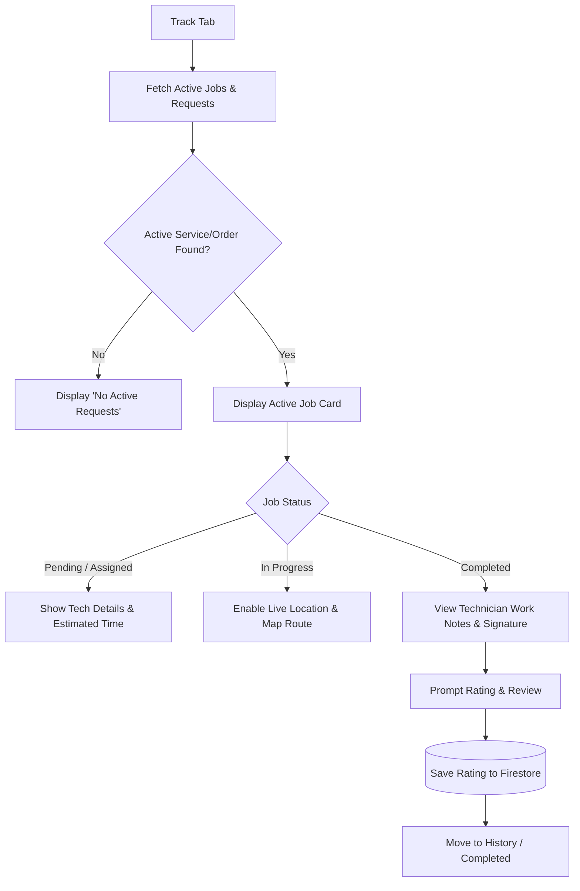
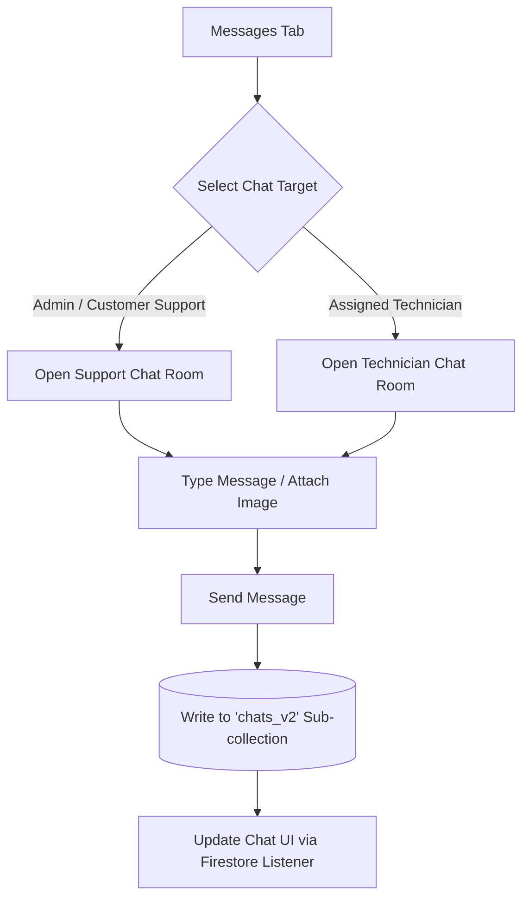
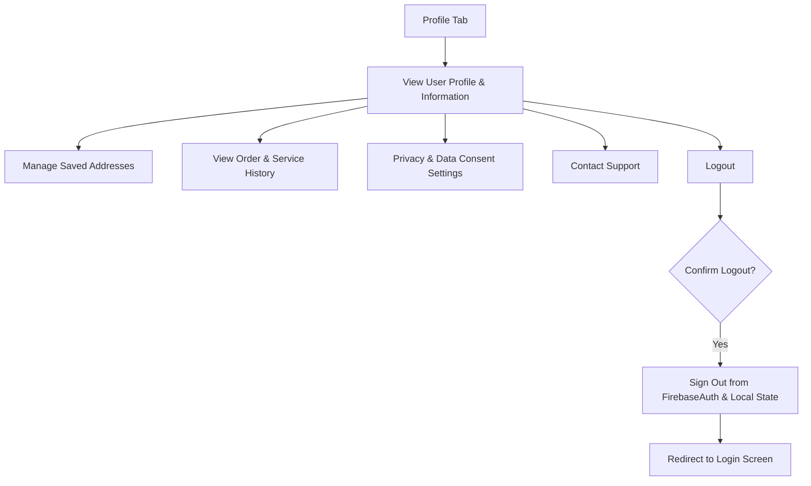

# CoolConnect - Customer Side System Flowchart

This document details the user journey, screen navigation, and state transitions for the **Customer Side** of the CoolConnect Android application.

---

## 1. Overall Customer App Navigation Flow

---

## 2. Detailed Sub-Flows

### A. Service Request & Booking Flow (Services Tab)

---

### B. E-Commerce & Product Purchase Flow (Shop Tab)

---

### C. Service Tracking & Real-Time Monitoring Flow (Track Tab)

---

### D. Messaging & Support Flow (Messages Tab)

---

### E. Account & Settings Flow (Profile / You Tab)

---

## 3. Customer State & Tab Summary

| Tab | Key Components | Primary Functions |
|---|---|---|
| **Home** | Recommended Services, Quick Banners, Maintenance Reminders | Overview of services, quick access to booking & active job banners. |
| **Services** | Category Picker, Address Selector, Schedule Picker | Booking HVAC cleaning, repair, or installation services. |
| **Shop** | Product Catalog, Cart, Checkout Dialog | Purchasing air conditioning units, spare parts, with optional installation. |
| **Track** | Map View, Technician Location Marker, Status Stepper, Rating Dialog | Real-time tracking of technician, ETA, completion proof, and reviews. |
| **Messages** | Message List, Chat Bubble View, Image Attachments | Communication with customer support and assigned technicians. |
| **Profile** | User Information, Service History, Address Book, Logout | Profile editing, order history logs, address management, app settings. |
